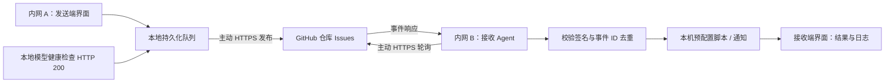

# Relay · 跨网络事件桥

两个互不直连的内网，各运行一个 Agent 和网页控制台，通过 GitHub Issues 交换签名事件。Python 3.10+、Linux/macOS，无第三方 Python 依赖。



这是事件桥：通知 B 执行本地操作，不会自动打通 A 的模型 API、传输模型权重或建立网络隧道。

## 启动两端

在内网 A：

```bash
cd /path/to/network-relay
python3 relay.py --role sender --port 8787 --data ./sender-data
```

在内网 B：

```bash
cd /path/to/network-relay
python3 relay.py --role receiver --port 8788 --data ./receiver-data
```

分别打开 `http://127.0.0.1:8787`、`http://127.0.0.1:8788`。两端有各自的发送 / 接收界面。同一个程序依本机角色展示页面，不是依靠两个页面共享同一内网服务。

程序只监听 loopback。部署在服务器时，通过 SSH 端口转发访问控制台，例如 `ssh -L 8788:127.0.0.1:8788 user@receiver-host`。网页会配置本机操作，不应直接暴露到公网。

两端点击“设置连接”，填写同一专用 GitHub 仓库、通道及共享密钥。仓库启用 Issues，两端均须能够访问 `api.github.com:443`。仓库可以是私有的，不需要 GitHub Actions 或 webhook。

发送端 Token 需要该仓库 Issues 读写权限；接收端只需读取。可用 fine-grained PAT，仅授权中转仓库。Token 也可通过 `GITHUB_TOKEN` 环境变量提供。共享密钥建议用 `python3 -c 'import secrets; print(secrets.token_hex(32))'` 生成，再在两端填写。

配置保存到各自数据目录 `config.json`，凭据不回传浏览器、不写入事件；配置文件权限为 0600。点击“保存配置”再测试已保存的连接，并启用自动任务。连接测试检查仓库及 Issues 可读性，发送权限在实际发布时确认。

若出网需要代理，可设置 `HTTPS_PROXY=http://proxy-host:port`，并设置 `NO_PROXY=127.0.0.1,localhost` 保持本机调用直连。当前无依赖版本支持 HTTP 代理转发，不包含 SOCKS 代理客户端。

## 两端的操作

发送端可直接填写通知，也可切换“模型就绪触发”，填写本机可访问的 `/health` 地址。检测到 HTTP 200 后发送一次 `model.ready`。等待记录持久化，进程重启后继续检查；不负责启动模型本身。

接收端默认处理 `notify`，把消息记录为完成。在设置中添加本地脚本映射，例如：

```json
{
  "notify": {"argv": [], "timeout": 30},
  "model.ready": {
    "argv": ["python3", "/absolute/path/network-relay/examples/on_model_ready.py"],
    "timeout": 300
  }
}
```

命令来自接收机器自身的配置；事件不会携带可直接执行的 shell 命令。`argv` 按参数数组执行，payload 不拼接进命令行。脚本通过 `RELAY_EVENT_ID`、`RELAY_EVENT_TYPE`、`RELAY_PAYLOAD_JSON` 环境变量取值。脚本的 cwd 继承 Agent 启动目录，建议使用绝对路径。

事件详情展示关联 GitHub Issue、处理结果、尝试次数和最后 16 KB 输出。完整脚本输出在数据目录 `<event-id>.log`，应按实际任务量定期归档。

## 用现有程序触发通知

发送端运行后，可调用本机 API，不需要在业务程序里直接管理 GitHub Token：

```bash
curl -fsS http://127.0.0.1:8787/api/send \
  -H 'Content-Type: application/json' \
  -d '{"type":"model.ready","payload":{"model":"MG46","message":"模型已就绪"}}'
```

API 的成功表示事件已持久化入队，不等于已发送，更不等于远端操作完成。分别查看发送端“已发布”和接收端“已完成”。目前没有反向执行回执，发送端不宣称知道接收端执行状态。

## 交付与恢复语义

默认每 10 秒轮询，通常检测延迟约 0–10 秒，加上网络与操作耗时。不是实时传输或高吞吐消息队列。默认事件有效期 24 小时；API 可传 `ttl`，范围 60 秒至 7 天。

发送失败采用持久化队列和指数退避重试。如果 GitHub 已接受事件但响应丢失，可能出现重复 Issue；事件 UUID 保持不变，接收端会去重。发送队列记录创建时的仓库，修改设置不会把旧事件重定向到另一个仓库。

接收端保存 issue 序号游标，首次会扫描已有事件，离线恢复后补读。用专用仓库避免混入大量业务 Issue。事件与游标在同一个 SQLite 事务中提交；失败的本地操作单独保留，不会因游标前进而丢失。已发布的事件按不可变消息处理：修改旧 Issue 不会再次触发，需发布新事件。

动作失败不会自动重跑，用户可在详情中核对后重试。进程在执行中崩溃，恢复后标为“待核对”，而非假设未执行。外部脚本应以 `RELAY_EVENT_ID` 实现自身幂等；本工具不承诺跨外部副作用的 exactly-once。通知是串行处理的，长脚本会延迟本机后续处理；任务较长时建议脚本只提交本地任务并尽快返回。

不同接收机可以各自接收同一事件；每台使用独立状态库。不能用同一个通道模拟多消费者竞争抢单。无需关闭 Issue，关闭状态也不会被漏读；接收者不会修改原事件。

共享密钥或通道更改后，旧签名事件可能不再被接收；应先处理完旧队列，再切换配置。公共仓库中的消息内容公开，模型内部地址等信息按需要放入私有仓库。

## 本地验证

```bash
python3 -m unittest discover -s tests -v
```

测试使用本地模拟的 GitHub API，不会向真实仓库发事件。部署联调需要用户指定中转仓库和凭据。

双端浏览器测试另见 `tests/browser_smoke.py`，需要 Playwright；`previews/` 为该模拟链路实际运行后的界面截图。

GitHub 官方接口依据：[Issues API](https://docs.github.com/en/rest/issues/issues)、[API 限流说明](https://docs.github.com/en/rest/using-the-rest-api/rate-limits-for-the-rest-api)。认证用户通常有每小时 5000 次主请求额度，仍受其他限流规则约束；单端 10 秒一次空闲轮询约 360 次/小时。
